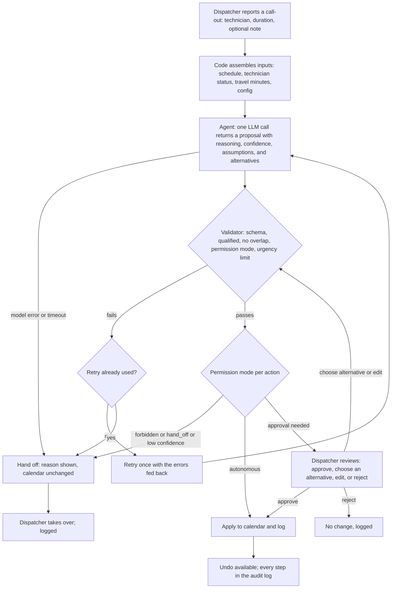

# Project Plan (Draft)

Working plan for the prototype and product artifact. Brief in [CONTEXT.md](CONTEXT.md). Completed work is logged in [TIMELINE.yaml](product-artifact/TIMELINE.yaml).

Conventions for this plan:

- **Given** means the case already establishes it. **TBD** means the author decides. Do not fill TBD items with guesses.
- Any number is a hypothesis: state the formula, inputs, and a confidence level. No proprietary data.
- Keep each section to about a page. Most effort goes to the prototype and scenarios.

## Phase 1: Customer

### 1a. Customers and users

- **Given (focus persona):** Office manager or dispatcher at a home service business with 7-10 field technicians, handling same-day disruptions.
- **Segments:**

  | Segment | Examples | Disruption hurts because |
  |---|---|---|
  | Route-based recurring | Home cleaning, pool | A call-out breaks a whole route of short stops and drive time grows |
  | On-demand, high-value (anchor) | Plumbing, HVAC, electrical | Jobs overrun, qualifications limit who can cover, and a lost job is costly |

- **By role:** buyer (owner), user (dispatcher or office manager; at small shops the owner dispatches), affected (technicians, homeowners).
- **Anchor:** On-demand, see [decision 0004](product-artifact/decisions/0004-anchor-on-on-demand.md). Route-based appears as a Settings choice (scheduling priority: drive time; profiles defined in `prototype/config/goals.yaml`, [decision 0016](product-artifact/decisions/0016-scheduling-priority-in-settings.md)).
- **Persona rationale:** The case sets the persona. On-demand is the anchor because it exercises qualifications and the revenue goal directly.
- **Evidence (TBD, assumptions until sourced):** Disruption frequency and difficulty for on-demand vs. route-based are unverified. Add outside references or a dispatcher conversation.

#### Personas (on-demand; hypotheses, not yet researched)

**Dispatcher or office manager (primary user, approver)**

- Goals: keep technicians productive, protect high-value jobs, keep customers informed, avoid blame when the day goes wrong.
- Context: interrupted constantly, juggling calendar, phone, and maps, deciding fast with incomplete information. Holds undocumented knowledge of who is good at what.
- Pain: manual juggling, mental load, time pressure.
- Needs: speed without surprise; see what changed and why; keep final say on anything affecting customers or technician pay.
- Fears: losing control, being blamed for an agent's mistake, cleanup after a wrong change.
- Confidence: medium on goals and pain, low on how much knowledge is undocumented.

*Industry variants of the dispatcher (same role, goals, and fears; different day and success measure; see [decision 0007](product-artifact/decisions/0007-industry-default-profile.md)):*

| | Route-based (cleaning, pool) | On-demand (plumbing, HVAC) |
|---|---|---|
| Dispatcher's day | Keeping fixed routes intact | Triage: who covers what, and which jobs matter most |
| Success looks like | Fewer miles, routes preserved | High-value jobs protected, urgent jobs not missed |
| Pain | A call-out breaks a whole route | Overruns and mismatched skills |
| Default goal profile | `drive_distance` | `job_revenue` |

**Field technician (context, not built; simulated input and notification target)**

- Goals: a predictable day, fair job allocation, short drives, jobs they are qualified and equipped for.
- Context: on-site and mid-job, carrying parts and tools for the planned jobs, slow to respond.
- Pain: last-minute changes, being pushed to the next job after an overrun, being sent without the right parts or skills.
- Interaction with the agent: reports a job running long, a call-out, or a possible customer reschedule, and is notified of resulting changes with a reason.
- Fears: being treated as interchangeable, losing good jobs, an unsafe or unqualified assignment.
- Confidence: low; least known persona.

**Customer (context, not built; homeowner with an urgent issue, notified through the dispatcher)**

- Goals: the problem fixed quickly, a reliable arrival window, clear communication.
- Context: disrupted by the issue itself (no heat, a leak), often home waiting.
- Pain: waiting without information, no-shows, being rescheduled without notice.
- Interaction with the agent: does not use it directly; the agent proposes customer messages, which need dispatcher approval.
- Fears: being deprioritized, a no-show, paying more for delay.
- Confidence: low; verify with outside sources.

**Design tension to show in a scenario:** a change that is best for the schedule can be bad for the technician or the customer.

### 1b. Jobs to be done

- **Jobs (dispatcher, on-demand; hypotheses):**

  | # | Trigger | Job |
  |---|---|---|
  | J1 | A job runs long | When a technician reports a job running over, I want to know which later jobs are affected and what my options are, so I can protect high-value and time-critical jobs. |
  | J2 | A technician calls out | When a technician can't work, I want to redistribute their jobs to qualified technicians, so I can avoid cancelling revenue. |
  | J3 | A customer reschedules | When a customer moves or cancels, I want to fill the gap or re-order the day, so I can avoid idle technician time. |
  | J4 | After any change | When the plan changes, I want technicians and customers told clearly and quickly, so I can avoid surprises, no-shows, and angry calls. |
  | J5 | Throughout | When I delegate any of this, I want to see what was done, why, and how to undo it, so I can stay accountable and trust it. |

  J1 to J3 are the case's disruption types. J4 and J5 apply to every disruption. "Recommend no change" is a valid agent outcome.

- **Redistribution rule ([decision 0006](product-artifact/decisions/0006-qualify-availability-proximity.md)):** Check qualification, then availability, then rank by the active goal profile (proximity is primary in the drive-distance profile and a tiebreaker in the revenue profile). If no qualified technician is available, use the remaining time on busy qualified technicians' current jobs to propose a delayed slot (within the job's urgency limit), or hand off. The revenue profile may also propose displacing a lower-priority job; this always needs dispatcher approval. Proximity is dynamic: an idle technician is measured from home or the office, and a technician on a job from that job's address.
- **Other constraints (low confidence):** technician fairness and workload, parts and tools on the truck, and customer promises (arrival windows, urgency such as no heat) outweighing convenience.

### 1c. Friction points

- **All friction points below are assumptions (A1), not research findings.** No dispatcher has been consulted and no outside source has been cited yet.

  | # | Friction | Type | Jobs |
  |---|---|---|---|
  | F1 | Working out who is qualified and free right now by checking skills, calendars, and memory | Effort, delay | J1, J2, J3 |
  | F2 | Not knowing when an in-progress job will really finish | Confusion, delay | J1 |
  | F3 | Estimating drive time and how a change ripples through the day | Effort | J1, J2 |
  | F4 | Weighing tradeoffs under pressure: which job to protect (revenue vs. urgency vs. customer promise) | Effort, trust in own decision | J1 to J3 |
  | F5 | Telling technicians and customers one by one by phone or text | Effort, delay | J4 |
  | F6 | Cascading effects: one change touches several jobs and the ripple is hard to see | Confusion | J1, J2 |
  | F7 | Risk of assigning an unqualified technician, causing rework or a failed job | Trust | J2 |
  | F8 | Trusting an automated change: not knowing why it happened or how to undo it | Trust | J5 |

### 1d. Prioritization

- **Scores are the author's hypotheses (A2), 1 to 3 per column.** Frequency is the least reliable column.

  | Disruption | Frequency | Severity | Business outcome | Total |
  |---|---|---|---|---|
  | Technician call-out | 2 | 3 | 3 | 8 |
  | Job running long | 3 | 2 | 2 | 7 |
  | Customer reschedule | 3 | 1 | 1 | 5 |

- **Reasoning:** A call-out hits several jobs at once and qualification limits bite; in the base data about $2,250 of jobs lose their technician. A job running long is more frequent but is the same logic in smaller form, so the design carries over. A reschedule mostly creates a gap.
- **Priorities among friction points:** F1 and F4 are core to the agent (this is where an LLM adds judgment). F5 is a cheap extra (the agent drafts messages). F8 feeds Phase 4 (trust).
- **Output:** The prototype and demo handle the technician call-out only ([decision 0012](product-artifact/decisions/0012-scope-technician-call-out-only.md)). This was chosen on pain plus demo value (A3): it forces qualification, a delay-versus-handoff choice, and a natural failure case. See [decision 0004](product-artifact/decisions/0004-anchor-on-on-demand.md) for the on-demand anchor.

### Assumptions register for Phase 1

Nothing here is confirmed by the case or by research. Each needs a source, a dispatcher conversation, or an explicit "hypothesis" label when presented.

| ID | Assumption | Where used | Confidence | How to firm up |
|---|---|---|---|---|
| A1 | The eight friction points are real and in this form | 1c | Low to medium | Dispatcher conversation, trade forums, vendor material |
| A2 | Frequency, severity, and outcome scores, especially frequency | 1d | Low | Dispatcher conversation or published data |
| A3 | Call-out is the right first disruption (partly demo value, not only pain) | 1d | Medium | Say it plainly in the artifact |
| A4 | On-demand disruptions are more frequent and harder than route-based (decision 0004) | 1a | Low | Outside source |
| A5 | Technician and customer personas (goals, fears) | 1a | Low | Outside source |
| A6 | Industry default profiles (plumbing and HVAC optimize revenue; cleaning and pool optimize drive distance) | 1a | Medium; the case states the pattern, mapping is ours | Cite the case, treat defaults as examples |
| A7 | Urgency tier delays (60 and 240 minutes) and job values in the synthetic data | Config, data | Low | Label as examples |
| A8 | The $2,250 at risk in the base scenario | 1d | Synthetic | Comes from invented data; do not present as a market figure |

## Phase 2: Strategy

- **2a. Direct value for Housecall Pro (hypotheses; no numbers sourced):** A scheduling agent is a premium, differentiating feature in the dispatch workflow. Value to estimate: (businesses that adopt it) x (price uplift or attach rate). Inputs we do not have: attach rate, price point, how many of the 7-10 technician businesses handle frequent disruptions. Confidence: low. Do not present any figure as fact.
- **2b. Indirect value for Housecall Pro (hypotheses):** Dispatchers who see the product absorb a stressful daily task are more engaged and less likely to leave; a visible, undoable, permissioned agent is a trust differentiator against competitors that add AI without control. Confidence: low, unmeasured.
- **2c. Customer value (hypotheses):** For the business: fewer lost or late jobs, fewer calls and texts, less dispatcher time per disruption. Formula to test: (disruptions per week) x (dispatcher minutes saved each) x (wage) + (jobs saved) x (average job value) x (margin). In the synthetic base case the call-out put $2,250 of work at risk (A8, invented data, not a market figure). Inputs need a dispatcher conversation or outside data.
- **Scope note:** The case does not ask for a business case. Keep Phase 2 to this level and spend the time elsewhere.

## Phase 3: Technology

- **3a. Overarching problem:** When a technician calls out the day of service, the dispatcher has to work out which jobs are affected, who is qualified and free, how far each technician must travel, and what the business should protect, all under time pressure and by hand. Good looks like a settled day with the important work covered and the dispatcher making only the decisions that matter. Failure looks like a job left uncovered without anyone noticing, a wrong or unqualified assignment, or a changed time a customer did not expect.
- **3b. How the AI solution solves it:**
  - **Goal:** cover the absent technician's jobs, optimizing the business's active goal profile (job revenue or drive distance), within urgency limits.
  - **Context (in one prompt, [decision 0011](product-artifact/decisions/0011-single-call-inputs-in-prompt.md)):** the live schedule, technician skills and locations, travel minutes, qualification rules, urgency tiers, customer notes, the goal profile, the permissions in effect, and the dispatcher's note.
  - **Tools:** none at run time. The model returns a structured proposal (reassign, delay, or hand off, with side effects, reasoning, assumptions, alternatives, and confidence). Code does the rest: validate, apply, log, undo.
  - **Permissions:** set by the dispatcher through the autonomy setting (requirement 16, [decision 0015](product-artifact/decisions/0015-autonomy-setting-never-recommended-always.md)). Recommended lets same-slot reassignments run on their own, and delays and schedule changes wait for approval.
  - **When it stops or hands off:** no feasible option, a plan below the confidence threshold, safety checks failing after one retry, or a model error. The schedule is unchanged and the reason is stated.
  - **One viable rule-based alternative:** a rules engine that takes each affected job in priority order and assigns the best-ranked qualified technician from a skills table who is free for the slot, delays it to the first free qualified technician if none is, and flags it otherwise.
  - **Why agentic is better here (argued, not measured):**
    - Free-text context cannot be encoded as rules: "not sure if I'll be back by 2pm", or a customer note.
    - Moves interact. Delaying one install pushes another technician's next job, and weighing that tradeoff across several jobs is where rules multiply and break.
    - Goals differ by business and industry. With rules, each business needs its own rule set; the agent takes the goal as configuration.
    - It explains the choice and offers alternatives in plain language, which a dispatcher needs in order to trust it.
  - **Where rules win, and what we keep:** rules are cheaper, faster, deterministic, and fully predictable, and they are enough when one job has one obvious free technician. So the design is a hybrid: the model judges, and deterministic code guarantees safety, permissions, logging, and undo. Weak spot: we did not run a head-to-head comparison, so the claim rests on the reasoning above.
- **3c. Risks:**
  - **Wrong proposal:** mitigated by the validator, approval, and undo; but the validator cannot judge quality, only feasibility.
  - **Confidence is self-reported and uncalibrated** (see Phase 4).
  - **Over-automation:** the Always setting lets schedule changes apply without a human; mitigated by undo, the low-confidence gate, and Recommended as the default.
  - **Untrusted text in the prompt:** customer notes and the dispatcher's note go to the model. A crafted note could try to steer it. The validator and permissions limit the damage, but the text itself is not sanitized.
  - **Privacy:** real customer data would go to a model provider; this prototype uses synthetic data only.
  - **Latency and cost:** about 20 seconds and about 4,000 output tokens per proposal on the small model with low thinking (decision 0013).
  - **Dependencies:** a single model provider (Pi with one Copilot login); there is no provider-neutral adapter and no fallback model, despite what decision 0010 originally intended (see its 2026-10-27 correction). A replay mode plays back three recorded real runs (S1, S5, S10) when the live model is unavailable ([decision 0018](product-artifact/decisions/0018-replay-mode-for-demo-safety.md)). Two npm audit findings in a transitive dependency are accepted for a local prototype.
  - **Stale or missing data:** the agent assumes the schedule and technician locations it is given are current.

### Process: from call-out to outcome

### Scope for the prototype

- **In scope:** One end-to-end slice with synthetic data, framed on one situation: a technician calls out the day of service and the agent handles rescheduling that technician's jobs ([decision 0012](product-artifact/decisions/0012-scope-technician-call-out-only.md)). It shows an agent decision with visible reasoning, a proposed or completed action, and an approval or failure path. The dispatcher is the only persona with a built interface ([decision 0005](product-artifact/decisions/0005-technician-reports-to-agent.md)). The call-out is triggered from the dispatcher view, and technician and customer notifications appear as mock previews; the dispatcher approves.
- **Configurable, not hardcoded:** Scheduling priority (job revenue or drive time, chosen in Settings), technician qualifications, and autonomy versus approval (Settings, with per-action modes in `prototype/config/`).
- **Out of scope:** A job running long and a customer reschedule (future work reusing the same reasoning), real Housecall Pro integrations, real data, authentication, production-grade routing.

### Open technical decisions

- Where the agent logic runs: a small local Node backend ([decision 0008](product-artifact/decisions/0008-local-prototype-hosted-artifact.md)).
- Whether the agent uses a real LLM or a scripted stand-in: a real LLM in one structured call with inputs in the prompt, validated by code ([decision 0011](product-artifact/decisions/0011-single-call-inputs-in-prompt.md)). The provider is Pi with the author's Copilot login, with no fallback ([decision 0010](product-artifact/decisions/0010-llm-provider-and-reliability.md) and its correction).

## Phase 4: Trust and Measurement

- **Inspect (built):** Every job in a proposal shows the agent's reasoning (at most two sentences), its confidence, whether it needs approval, and what it was before. The proposal lists the assumptions the agent made, at most one alternative per job with its tradeoff (delay, revenue or job at risk), and the safety-check results. Time and token use are shown. The audit log records every call-out, proposal, automatic change, approval, rejection, undo, setting change, and simulated customer message. Gap: the exact inputs given to the model were removed from the screen to cut clutter, though the server keeps them; decide whether to restore a link to them.
- **Correct and undo (built):** Before approving, the dispatcher can switch a job to the agent's alternative (re-validated), restore the agent's original, approve the rest, or reject. After anything is applied, one undo reverses the whole plan, including the parts that ran automatically, and logs it. Customers who were told about a new technician get a simulated correction. Known gap: undo restores the schedule but not the technician's called-out status, so the day must be reset to repeat a report. Not built: undoing one change within a plan, or editing a proposal freely (FE4).
- **Recover (built, partly tested):**
  - **Agent wrong:** the validator blocks proposals that break qualification, availability, travel, urgency, or the day's end. It sends one correction back to the model; if the second attempt fails, the jobs are handed to the dispatcher with the reasons. Run live as S5 (an injected unsafe plan was caught and the agent recovered).
  - **Agent uncertain:** a plan below the confidence threshold waits for approval whatever the autonomy setting, and ambiguous notes are surfaced as stated assumptions (S6, not yet run live).
  - **No feasible option:** the job is handed off with the reason and the rest of the plan is still proposed (S4, not yet run live).
  - **Tool or model failure:** the server turns a model error into a hand-off and leaves the schedule unchanged. Coded, but not triggered live.
  - **Wrong after it was applied:** undo, as above.
- **Trust over time (direction, not built):** Use the confidence level as a learning signal. Record what the dispatcher does with each proposal (approved unchanged, switched to an alternative, rejected, undone) and, later, customer sentiment, and use that history to set the confidence rules that decide what may run on its own. Where an action type has a strong approval record, offer to raise it toward Always; where it is often undone, lower it. The dispatcher stays in control: the system recommends the autonomy level (requirement 16) and the dispatcher accepts it. Not built; the prototype only logs approvals, rejections, and undos. Weak spot: with one dispatcher's few decisions per day this learns slowly, and customer sentiment needs a source that does not exist yet (assumption).
- **REVISIT: confidence is self-reported, not calibrated.** The model states its own 0 to 1 confidence (job and plan); code only checks the range and compares the plan value with `handoff.min_confidence` (0.7) to force approval. A stated 90% does not mean right 90% of the time, and this has not been tested. Decide before the artifact: present it as a rough uncertainty signal (the validator is the real guarantee), and under measurement describe calibrating it against dispatcher outcomes (approved unchanged vs. edited, rejected, undone) and tuning the threshold from that.
- **Outcome metrics (hypotheses; none measured, the data is synthetic):**
  - **Dispatcher effort:** minutes from the call-out to a settled schedule, and number of calls or texts the dispatcher still has to make (friction F5).
  - **Customer and revenue:** jobs still completed the same day, revenue at risk that was covered, jobs lost or cancelled, and customer complaints about a changed technician or time.
  - **Industry goal:** under the revenue profile, revenue covered; under the drive-distance profile, drive minutes added per disruption.
  - **Technician load:** overtime and ending the day late.
  - **Baseline needed:** the same measures for dispatchers handling disruptions manually, which we do not have. Collect it before shipping.
  - **Agent-quality signals from dispatcher behavior:** proposals approved unchanged, approved after switching an alternative, rejected, or undone; hand-off rate; and how often the first attempt fails the safety checks. These also feed trust over time and confidence calibration (above).
- **Quality bar before shipping (proposed thresholds, unsourced, to be set against the baseline):**
  - **Decisions:** zero proposals applied that break qualification, availability, travel, or urgency (the validator guarantees this; verify with a replay set of past or synthetic disruptions, including the failure cases). Dispatchers accept at least about 80% of proposals unchanged or after one switch, and the acceptance rate is clearly higher for plans at or above the confidence threshold than below it, which is the calibration check.
  - **Actions:** every applied action is logged and undoable, and undo restores the prior schedule in every test. An automatic action is undone less than about 5% of the time; above that, the setting reverts to approval for that action type.
  - **Handoffs:** every hand-off states a reason; none is silent; and hand-offs are neither too many (the agent is not useful) nor missing where no option fits (spot-checked by a dispatcher).
  - **Rollout:** shadow mode first (proposals shown, nothing applied), then Recommended for a few businesses, and Always only where the record supports it.

## Product requirements and acceptance criteria

Written independently of the demo: what the same-day scheduling agent must do as a product. The prototype covers a subset and is scoped to the technician call-out ([decision 0012](product-artifact/decisions/0012-scope-technician-call-out-only.md)); see Prototype coverage below.

**A. Intake**

| # | Requirement | Acceptance criteria |
|---|---|---|
| 1 | Accept a same-day technician unavailability: who, from when, for how long, and optional free-text context | The agent identifies every affected job. If the input is ambiguous, it states its assumption instead of guessing silently. |

**B. Decide and propose**

| # | Requirement | Acceptance criteria |
|---|---|---|
| 2 | Produce a plan with one outcome for every affected job: reassign, delay, or hand off | No affected job is left without an outcome. |
| 3 | Respect hard constraints: technician qualifications, no double-booking, enough time to travel between jobs, working hours | An action that violates one is never executed, and every collision a plan creates is resolved by a listed side effect. |
| 4 | Optimize toward the business's configured goal (for example job revenue vs. drive distance) | Changing the goal changes decisions where a tradeoff exists, and the explanation names the goal. |
| 5 | Respect job urgency: a maximum acceptable delay per urgency level | A delay beyond the limit is never proposed; the agent hands off instead. |
| 6 | Explain each decision: the reasoning (citing the facts used), confidence, assumptions, and alternatives rejected | A dispatcher can read all of it without leaving the screen; the raw inputs are not shown on the dispatcher screen (see Interface requirements). |
| 7 | Offer other options with their tradeoffs (for example a later slot, potential loss of revenue or of the job) | Each alternative states what it costs; the dispatcher can choose one in place of the default. |

**C. Configuration**

| # | Requirement | Acceptance criteria |
|---|---|---|
| 8 | A business sets, without code changes: the goal profile, technician qualifications (including per-person overrides), which actions are autonomous, approval-needed, or forbidden, urgency limits, and the confidence threshold for handoff | A changed setting takes effect on the next disruption. |

**D. Control**

| # | Requirement | Acceptance criteria |
|---|---|---|
| 9 | Act according to permissions | Autonomous actions run and are logged. Approval actions wait. Forbidden actions never run, and the agent hands off. Each action in a plan is judged on its own, so one plan can have changes that run immediately and others that wait. |
| 10 | The dispatcher can approve or reject a proposal | Rejection leaves the schedule unchanged. |
| 11 | The dispatcher can edit a proposal before approving it | An edited proposal passes the same constraint checks before it is applied, and the edit is logged. |
| 12 | Every applied action can be undone | Undo restores the prior state and is logged. |
| 15 | Low-risk changes run on their own; schedule changes never do ([decision 0014](product-artifact/decisions/0014-reassignments-autonomous-delays-approval.md)) | Moving a job to another qualified technician at the same time needs no approval, and the customer is sent an update that a new technician is assigned. Delayed slots, shifted times, displacement, and rescheduling always need the dispatcher, even if a setting says otherwise. A change that only exists because of another change waits with it. |
| 16 | The dispatcher sets how much the agent may do on its own ([decision 0015](product-artifact/decisions/0015-autonomy-setting-never-recommended-always.md)) | A Settings button at the top of the page opens an agent-autonomy choice: Never (every change needs approval), Recommended (requirement 15, the default), or Always (no approvals required). The same panel sets the **scheduling priority** (Job revenue or Drive time), which decides what the agent optimizes ([decision 0016](product-artifact/decisions/0016-scheduling-priority-in-settings.md)); the profiles themselves stay defined in config. It applies to the next call-out, is logged, and is kept across a day reset. Under any level the safety checks still apply, the agent never cancels a job, and a low-confidence plan still goes to the dispatcher. Always lets delays and schedule changes run without approval, which overrides the fixed rule in requirement 15 only when the business chooses it. |

**E. Failure and uncertainty**

| # | Requirement | Acceptance criteria |
|---|---|---|
| 13 | Hand off to the dispatcher, with the reason and the work done so far, when there is no feasible option, confidence is below threshold, validation fails after one retry, or the model or a tool fails | The schedule is unchanged, the reason is stated, and the failure is never silent. |

**F. Trust and audit**

| # | Requirement | Acceptance criteria |
|---|---|---|
| 14 | Keep an audit log of every proposal, its inputs, the reasoning, who decided, what was executed, and any undo | The log can be read in order and filtered by action. |

**Quality attributes:** a proposal within a stated time (assumed 30 seconds, untested); synthetic data only; a model that can be changed by environment variable (a different provider would need a small adapter, which does not exist yet); room to add other disruption types later.

### Future enhancements for the product artifact

In the product vision and artifact, not built in the prototype.

| # | Enhancement | Why it matters |
|---|---|---|
| FE1 | Report approval and override rates per action type, so a business can raise autonomy deliberately | How trust builds over time |
| FE2 | Draft notifications for changes that need approval (such as a delayed slot) to affected technicians and customers, subject to the same approval permissions. The customer update for a simple reassignment is already simulated in the prototype (requirement 15) | Removes the manual calling and texting (friction F5) |
| FE3 | Record events for outcome metrics: time to resolution, accepted, edited, and rejected proposals, handoff rate and reasons, undo rate, constraint violations caught, latency | Measurement; the audit log supplies the raw data |
| FE4 | Interactive re-planning: the dispatcher converses with the agent to explore options beyond those it offered, and the agent recomputes tradeoffs | Extends requirement 7 |
| FE5 | Other disruption types: a job running long and a customer reschedule | Reuses the same reasoning |
| FE6 | Displacement proposals, approval-gated | Protects higher-value jobs |

### Prototype coverage

| Requirements | In the prototype |
|---|---|
| 1 to 6, 8 to 10, 12 to 16 | Built for the technician call-out (the customer update in 15 is a simulated message; 16 is a three-level setting, not per-action control) |
| 7 and 11 | Simulated: the model's alternatives, each with its tradeoff, come from the same response; the dispatcher picks one and it is validated and logged. Free-form editing and interactive re-planning are FE4 |
| FE1 to FE6 | Described in the artifact only |

### Interface requirements (dispatcher screen)

How the product should present its decisions, so a dispatcher can scan the page quickly. Each came from review of the prototype screen against common interface practice.

| # | Requirement | Acceptance criteria |
|---|---|---|
| UI1 | The decision comes first | The proposal's status is the largest text in the proposal, and Approve and Reject sit beside it and stay visible while the proposal scrolls |
| UI2 | One highlight per job row | Each affected-job row has one filled highlight, the new outcome; whether it needs approval and the confidence are plain text. A row with alternatives gets a separate outlined flag when collapsed |
| UI7 | Alternatives are unmistakable | An expanded alternative has an arrow, a tinted outlined box, and its own button that names the job and sits inside that box, so it clearly applies to that alternative only |
| UI3 | Never color alone | Every status and outcome is stated in words as well as shown in color |
| UI4 | Confirm destructive actions | Resetting the day asks for confirmation before it clears anything |
| UI5 | Plain-language history | The audit log reads as sentences a dispatcher would say, with no technical terms; it is collapsed by default and its latest event stays visible |
| UI6 | Keep developer detail off the screen | The raw inputs given to the agent are not shown; token counts appear only inside the collapsed details; the affected jobs are introduced by a bold "Affected Jobs:" label |

Decisions behind UI5 and UI6: the audit log stays on the dispatcher screen because it is the evidence for the trust requirements (14, 12) and the case's "inspect, correct, undo" question, but collapsed to save space. The raw inputs were removed because a dispatcher does not need them; the reasoning already cites the facts used, and the inputs belong in the artifact (A5).

### Prototype demonstration choices

These are demo mechanics, kept apart from the product requirements above:

- The call-out is entered as a form (technician, duration) plus an optional free-text note.
- A read-only day view shows each technician's row and job blocks, the proposal as outlined "ghost" blocks, and updates on approve and undo. No drag and drop.
- Config (goals, permissions) is changed by editing YAML and reloading. Flipping reassignments between autonomous and approval demonstrates requirements 9 and 15.
- Choosing the scheduling priority in Settings (job revenue or drive time) demonstrates requirement 4; `active_profile` in `goals.yaml` is only the starting default.
- The validator is demonstrated with an injected bad proposal, labelled as injected.
- Scenarios are stored as data and selectable from the page.

### Confirmed vs. assumed

| Confirmed (case or author) | Assumed |
|---|---|
| Dispatcher persona, on-demand anchor, call-out only | Expected scenario behavior below is reasonable behavior, not a spec |
| One LLM call via Pi and Copilot, validated by code | The model returns valid structured output reliably (untested) |
| Autonomy shown by a config toggle; YAML edited and reloaded | Copilot usage limits will not interrupt the demo |
| Failure cases: no qualified technician free in time; validator rejects a bad proposal | A bad proposal can be injected in a test mode to show the validator (labelled as injected) |
| Call-out input is a form plus an optional note | Urgency limits and job values are examples |
| Artifact is an HTML page on GitHub Pages | |

## Test scenarios

All ten are call-outs against the base data. S1 to S8 use Dana Ortiz (plumbing and gas-certified, out at 10:30); S9 and S10 use other technicians. The scenarios are defined in `prototype/config/scenarios.yaml` ([decision 0017](product-artifact/decisions/0017-plan-impact-and-scenarios-in-yaml.md)). Expected behavior is a hypothesis to check against the real agent, not an exact output.

| # | Scenario | Setup | Expected behavior | Friction |
|---|---|---|---|---|
| S1 | Base call-out, revenue profile | Dana out for the day | The $1,850 install gets a qualified technician (Aisha, free 12:15) in a delayed slot within the urgency limit; the drain and faucet jobs go to qualified, available technicians; all need approval | F1, F4, F7 |
| S2 | Same call-out, drive-distance profile | Scheduling priority set to Drive time (Settings; the demo scenario applies the same override) | Different choices than S1 for at least one job, driven by proximity; reasoning mentions the profile | F3, F4 |
| S3 | The business approves every change | Set `reassign_job` to approval | Even the simple reassignments wait for approval with the rest of the plan; nothing is applied until the dispatcher approves | F5, F8 |
| S4 | Failure: nobody qualified and free in time | Aisha unavailable, or the install set to an emergency tier | Agent hands off the install with the reason; the other jobs are still proposed | F1, F7 |
| S5 | Failure: validator catches a bad proposal | Injected proposal assigns the install to Chloe (gas-certified, not a plumber) | Validator rejects it, one retry, then handoff; the calendar is unchanged | F7, F8 |
| S6 | Ambiguous note | Note says "not sure if I'll be back this afternoon" | Agent states its assumption, covers the confirmed part, and flags uncertainty or lowers confidence | F2, F4 |
| S7 | Approve then undo | Approve the S1 plan, then undo | The calendar returns to its original state and the log shows both steps | F8 |
| S8 | Choose an offered alternative | In S1, pick an alternative the agent offered (for example a later slot or a different technician) | The alternative states its tradeoff, passes validation, is applied on approval, and the choice is logged | F4, F8 |
| S9 | HVAC specialist out | Tom (HVAC) cannot work; the other two HVAC technicians have jobs nearby in time | A reassignment, delay or hand-off with a stated reason; not yet run live | F1, F4 |
| S10 | Easy day, one drain job | Marcus is out for the day with one simple drain job | A single reassignment that runs without approval under Recommended, with a customer update | F5 |

Every scenario is stored as data and traces to the friction points in Phase 1c. S5 uses an injected proposal and must be labelled as such in the demo.

## Items for the product artifact

Agent mechanics that were shown on the prototype screen. The dispatcher-facing screen stays free of them; they belong in the artifact.

| # | Item | Was shown | What to say in the artifact |
|---|---|---|---|
| A1 | Active goal profile (job revenue vs. drive distance) | Header badge (removed) | Goals are configuration per business, with industry defaults (decision 0007); how the profile changes decisions (S2); requirements 4 and 8 |
| A2 | Permission mode per action (autonomous, approval, forbidden) and how a business changes it | Header list (removed) | The autonomy model, how trust builds over time, and per-action approval as a future enhancement (S3, FE1); requirements 8 and 9 |
| A3 | Model, provider, and thinking level | Header line (removed) | Why this model and thinking on at a low level, and the latency and cost tradeoff (decisions 0010 and 0013) |
| A4 | Time and tokens per proposal | Proposal card and audit log (now only inside the collapsed details) | Measurement: cost per resolved call-out and latency (FE3) |
| A5 | The inputs provided to the agent, and the safety-check results per attempt | Proposal card (raw inputs removed from the screen; safety checks stay in the collapsed details) | Inspectability: how a dispatcher sees the basis for an action, with the raw inputs shown in the artifact; what the validator guarantees (decision 0009) |
| A6 | The wait message that mentioned thinking | Spinner text (reworded) | Why a plan takes up to half a minute and how the UI makes the wait visible |
| A7 | Scenario presets and test overrides (injected unsafe proposal, urgency override, permission overrides) | Demo-only panel | The test set of scenarios, and honesty that S5 injects a failure |
| A8 | The synthetic-data notice | Header (moved to the footer) | Data policy: synthetic data only |

## Steps

To be broken down once the phases above are filled in. Then they move into `planned_steps` in the timeline.
