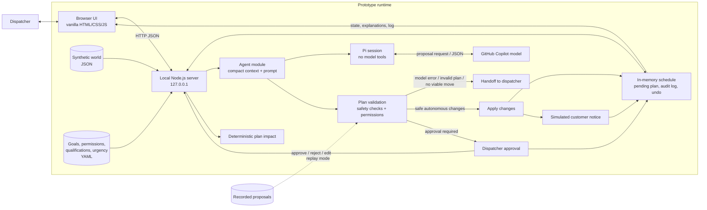

# housecall-pro

A prototype same-day scheduling agent for home service dispatchers, built for an interview case. It uses synthetic data only. The written artifact is `docs/index.html`.

## Architecture



In replay mode, recorded model proposals replace live model calls; they still pass through the live validation, permission, and approval flow. Schedule state, history, and settings are held in server memory and reset when the server restarts.

## Run the prototype

1. Install [Node.js](https://nodejs.org) (developed on v24).
2. In a terminal, go to the prototype folder and install dependencies:
   ```
   cd prototype
   npm install
   ```
3. Start the server:
   ```
   node server.mjs
   ```
4. Open http://127.0.0.1:3000. The server listens on your machine only.
5. Pick a test scenario, click **Ask the agent**, then approve, reject or undo the result. Use **Settings** to change agent autonomy and scheduling priority.

The live agent calls a model through [Pi](https://www.npmjs.com/package/@earendil-works/pi-coding-agent) using a GitHub Copilot login, so you need a Copilot account signed in to Pi. Without one, use replay mode.

## Replay mode (no login needed)

Plays back recorded real proposals for scenarios **S1**, **S2** and **S6**. The safety checks, approval and undo still run live.

- PowerShell: `$env:REPLAY = "1"; node server.mjs`
- macOS or Linux: `REPLAY=1 node server.mjs`

Reset the day before each scenario. Other scenarios and custom reports are not available in replay mode.


