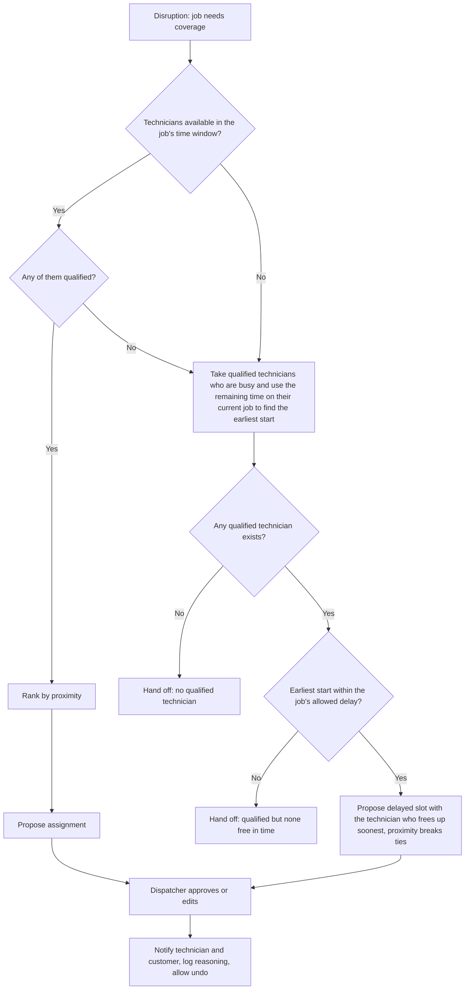

# 0006: Check availability, then qualification, then rank by proximity

- **Status:** accepted
- **Date:** 2026-10-27

## Context

When a job must move to another technician (call-out, overrun), the agent needs an order of operations. Qualification is a safety and quality constraint. Availability decides whether a technician can take the job in time. Proximity reduces drive time and delay.

## Options considered

1. Score qualification, availability, and proximity together as weighted goals: flexible, but a high proximity score could outweigh a missing qualification or a busy technician.
2. Ordered steps: availability, then qualification, then proximity ranking, with a fallback when nobody is free.

## Decision

Option 2, in this order:

1. **Availability (hard filter):** keep technicians who can take the job in its time window, accounting for when their current job is expected to finish.
2. **Qualification (hard filter):** among those, keep technicians qualified for the job, using `docs/config/qualifications.yaml` (including overrides).
3. **Proximity (ranking):** rank the remaining technicians by proximity to the job.

**Fallback when no technician is both available and qualified:** availability also informs the schedule. Take the qualified technicians who are busy, use the time remaining on each one's current job to find their earliest start, and propose a delayed slot with the one who frees up soonest (proximity breaks ties). The existing job is not moved. If the earliest start exceeds the job's allowed delay, or nobody is qualified, the agent hands off to the dispatcher and reports why. Delayed slots always need dispatcher approval.

Proximity is dynamic and based on the technician's current status:

- **Idle:** measured from where they are, either home or the office.
- **On a job:** measured from that job's address.

The status and location therefore live in the technician data and change as the day progresses.

## AI involvement

The author specified the rule, the order (availability first), and the delayed-slot fallback. Copilot recorded it, raised the availability gap for technicians mid-job, noted that the order of two pure filters does not change who passes them (only the handoff reporting), and flagged that `docs/config/goals.yaml` weights may overlap with the proximity ranking.

## Consequences

The no-qualified-technician and qualified-but-none-free cases become natural failure and handoff scenarios. Technician data needs a status, a current location, and an expected finish time for any current job. Each job or job type needs an allowed delay (urgency), which belongs in config and is not yet added. Open question:

- Whether proximity is the fixed ranking for every goal profile or the profile can change the ranking among available, qualified technicians. Revenue weights then apply to which jobs are protected, not which technician is chosen. To be reconciled in the config.
