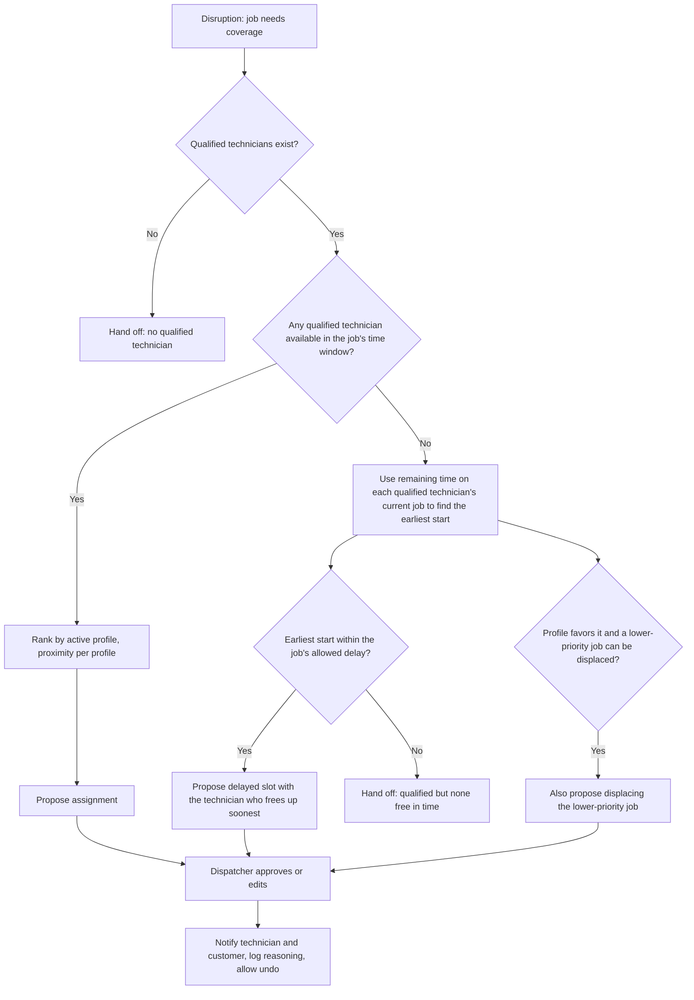

# 0006: Qualify, check availability, then rank by the goal profile

- **Status:** accepted as guidance; the fixed pipeline is superseded by [0009](0009-llm-agent-with-read-only-tools.md), so this order is prompt guidance, not code
- **Date:** 2026-10-27

## Context

When a job must move to another technician (call-out, overrun), the agent needs an order of operations. Qualification is a safety and quality constraint. Availability decides whether a technician can take the job in time. The case requires different workflows by industry and customer: drive distance for recurring work, job revenue for plumbing and HVAC.

## Options considered

1. Score everything as weighted goals: flexible, but a high score could outweigh a missing qualification or a busy technician.
2. Fixed hard constraints, then a profile-driven ranking: qualification, then availability, then ranking by the active goal profile, with a fallback when nobody is free.
3. Proximity as the fixed ranking in every profile: simple, but the profile switch would not change who covers a job, which undercuts the case's shared-versus-configurable requirement.

## Decision

Option 2, in this order:

1. **Qualification (hard filter, fixed):** keep technicians qualified for the job, using `prototype/config/qualifications.yaml` (including overrides). This is the qualified pool.
2. **Availability (hard filter, fixed):** within the pool, keep technicians who can take the job in its time window, accounting for when their current job is expected to finish.
3. **Ranking (profile-driven):** rank the remaining technicians by `technician_ranking` in the active profile in `prototype/config/goals.yaml`. Proximity is primary in the drive-distance profile and a tiebreaker in the revenue profile.
4. **Job priority (profile-driven):** when capacity is short, order jobs by `job_priority` in the active profile (urgency and job revenue for the revenue profile).

Proximity is dynamic and based on the technician's status. An idle technician is measured from home or the office. A technician on a job is measured from that job's address.

**Fallback when no qualified technician is available:** reuse the qualified pool. Use the time remaining on each busy technician's current job to find their earliest start, and propose a delayed slot with the one who frees up soonest (the profile's ranking breaks ties). If the earliest start exceeds the job's allowed delay (`prototype/config/urgency.yaml`), or the pool is empty, hand off and report why.

**Displacement option:** when the active profile favors it and covering a higher-priority job requires bumping a lower-priority one, the agent may propose displacing the lower-priority job. This is never autonomous; `displace_job` and `propose_delayed_slot` require dispatcher approval in `prototype/config/permissions.yaml`.

## AI involvement

The author specified the order, the delayed-slot fallback, proximity as a tiebreaker in the revenue profile, and the approval-gated displacement option. The author changed the filter order twice and settled on qualification first because the fallback reuses the qualified pool. Copilot's first recommendation kept proximity first in both profiles; the author caught that this contradicted the case's revenue requirement.

## Consequences

The no-qualified and qualified-but-none-free cases are natural failure and handoff scenarios. One scenario should show the same disruption producing different decisions under the two profiles. Technician data needs a status, a current location, and an expected finish time for any current job. Job data needs a value and may override its urgency tier. Goal criteria such as `revenue_protected` still need precise definitions when the agent logic is built.
